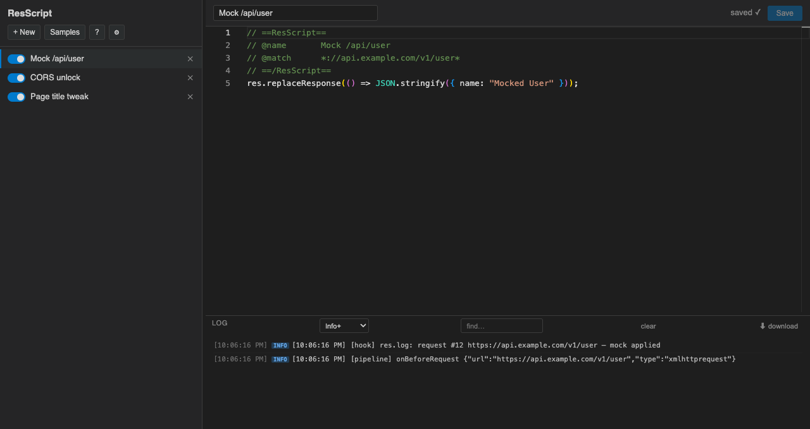
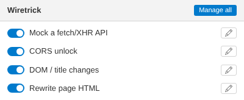
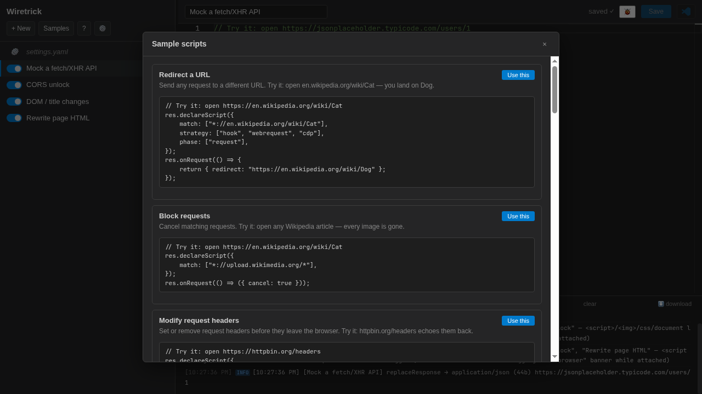

# ResScript Override (v2 — TypeScript rewrite)

A ground-up TypeScript rewrite of [Resource Override](https://github.com/kylepaulsen/ResourceOverride).
Instead of rule lists, the entire interface is a **script editor**: you write small
scripts (Violentmonkey/Tampermonkey style) that declare which URLs they activate on
and what they do — redirect requests, modify request/response headers, transform
response bodies, or replace them entirely. Each script has an enable/disable toggle.

**The manager** (script list, Monaco editor with IntelliSense, live LOG panel):



**The popup** (toolbar quick-toggle for the active tab's scripts):



**Sample scripts** (? → Samples — ten one-click starters):



## Install

**From a release (recommended):**

1. Grab `rescript-override-vX.Y.Z.zip` from [Releases](https://github.com/nimatrueway/rescript-override/releases) and unzip it.
2. Open `chrome://extensions` (or `about:debugging#/runtime/this-firefox` on Firefox).
3. Enable **Developer mode** (top-right), click **Load unpacked**, and select the unzipped `dist` folder.
4. Pin the 🧩 icon — the badge shows how many scripts are active on the current tab.

**From source:**

```bash
git clone https://github.com/nimatrueway/rescript-override.git
cd rescript-override
npm install && npm run build
# then: chrome://extensions → Developer mode → Load unpacked → dist/
```

> Requires an MV2-capable Chromium (ungoogled-chromium or any Chromium ≤ ~126) or
> Firefox. Modern stable Chrome (155+) removed MV2 and will refuse to load it.

**Releases are automated** — pushing a `vX.Y.Z` tag runs the GitHub Action
(typecheck → tests → build → zip → GitHub release), so the zip always matches
the tagged `manifest.json` version.

## Writing scripts

```ts
res.declareScript({
    match: ["*://app.example.com/api/user*"],
});

// Redirect / cancel / request headers (synchronous):
res.onRequest((ctx) => {
    // return { redirect: "https://myserver/user.json" };
    // return { cancel: true };
    return { headers: { set: { "x-debug": "1" } } };
});

// Response headers:
res.onResponseHeaders((ctx) => {
    return { headers: { set: { "access-control-allow-origin": "*" } } };
});

// Replace the whole body:
// res.replaceResponse(() => JSON.stringify({ mocked: true }));

// Stream-modify the body:
res.modifyResponse((ctx, body) => body.replace('"role":"user"', '"role":"admin"'));
```

`res.declareScript` is the only way to activate a script.
A source file without it is a **library**: inert on
its own (never matches, hidden from the popup) but importable by other
scripts:

```ts
// saved script named "utils" (utils.ts in the synced folder):
export function forceFail(url: string) { /* ... */ }

// in your script:
import { forceFail } from "./utils";   // "./utils", "utils", "utils.ts" all resolve
```

### Parameters — adjustable knobs

`params` are typed knobs the user changes from the popup's ⚙ dialog without
touching the script:

```ts
const cfg = res.declareScript({
    match: ["*://app.example.com/*"],
    strategy: ["hook", "cdp"],
    params: {
        enabled: { type: "boolean", default: true, description: "Master switch" },
        status:  { type: "enum", choices: ["500", "503"], default: "500" },
        note:    { type: "string", default: "forced failure" },
        tags:    { type: "stringList", default: [] },
    },
});
// cfg.enabled: boolean · cfg.status: "500" | "503" · cfg.note: string · cfg.tags: string[]

res.onRequest((ctx) => {
    if (!cfg.enabled) return;
    return { respond: { status: Number(cfg.status), body: { error: cfg.note, tags: cfg.tags } } };
});
```

Param values persist per script and apply on save — the change hot-reloads
like a code edit. Parameter types: `boolean` (switch), `string` (text; add `multiline: true` for a textarea, written to
`settings.yaml` as a `|` block scalar when it contains newlines),
`enum` (dropdown of `choices`), `stringList` (add/remove list).

## Editor

The manager page embeds **Monaco** (the VS Code editor) with full TypeScript
IntelliSense for the `res` API — completions, hover docs, and diagnostics work
out of the box. Cmd/Ctrl+S saves and hot-applies the script; ⌘P quick-opens
scripts/settings.yaml (cursor position is remembered per file and restored
when you switch back), ⌘, opens Settings, ⌘/ comments, ⌘F finds, ⌘D selects
the next occurrence. The 🐞 button in the toolbar opens `chrome://extensions`
— click **background page** under *Inspect views* to debug the engine (MV2
has no API to open DevTools for the live background page programmatically).
Reverting an edit back to the saved text (or the name to the stored one)
clears the unsaved-changes state — no discard prompt on a no-op edit.

### Dedicated scripts folder

Click **Folder…** and pick a folder (e.g. `~/ResScripts`) — that becomes your
scripts home: every script is written there as a `.ts` file along with
`res-api.d.ts` and `jsconfig.json`. Edit in VS Code (or any editor) with full
TypeScript completions; saves hot-reload into the engine instantly.

Sync is two-way and watches the folder for **creates, renames/moves and
deletes** too: a new `.ts` file becomes a script, deleting a file removes its
script, renaming a file renames the script. The folder choice is remembered —
the manager reconnects automatically on open (one click to re-grant after a
browser restart, per Chrome's File System Access rules).

### `settings.yaml`

The script list always has a ⚙ **settings.yaml** entry (no folder needed; no
toggle, not deletable). It is generated from storage: global settings plus
every script's params and `enabled` state. Saving it in the editor applies it
(syntax errors show in the editor status and change nothing). Popup/list
changes patch the matching entries. With a scripts folder connected the same
file is mirrored to `settings.yaml` there and edits sync both ways.

The file starts with a `# yaml-language-server: $schema=./settings.schema.json`
modeline and the folder sync writes that schema next to it, so VS Code's YAML
extension validates the file as you edit it.

Formatting is preserved: an existing, parsable file is patched in place (only
the changed value is rewritten; comments, blank lines, spacing and section
order stay). A value returned to its default is rewritten as a live entry; new
scripts/keys are inserted into the existing file. The file is generated from
scratch only when missing or unparsable.

Every option has its description above it; options at their default are
commented out, only non-default values are live entries. `enabled` is live only
when `false`. Params are keyed by script name; libraries are omitted.

```yaml
# yaml-language-server: $schema=./settings.schema.json
settings:
  # Minimum log level shown in the panel: debug | info | warn | error
  # logLevel: info

params:
  Debug header:
    # Run this script
    enabled: false
    # Value of the x-debug header
    # default: warn
    level: trace
```

## Interception strategies — how bodies get modified

Chrome and Firefox have fundamentally different extension APIs, and Chrome
itself can only reach some resources through some paths. ResScript therefore
has **interception strategies** — pickable per script, individually or as a
**comma-separated priority list**:

```ts
res.declareScript({
    match: ["*://api.example.com/*"],
    strategy: ["hook", "cdp"],   // ← try these in order
});
```

| strategy | how it works | can see | banner? | notes |
|---|---|---|---|---|
| `hook` | MAIN-world content script overrides `fetch`, `XMLHttpRequest`, `Response` consumers | any request the page's own JS makes (fetch/XHR — the majority of API traffic) | **never** | misses `<script src>`, ``, documents; requires the page context |
| `cdp` | `chrome.debugger` + CDP Fetch domain: pause response → read body → transform → fulfill | **everything**: documents, script tags, images, fonts, XHR — even requests the page didn't initiate | **yes** — Chrome shows a yellow "being debugged" bar while attached | the only network-level path for main-frame HTML and non-JS resources on Chrome; attach/detach is lazy and automatic |
| `proxy` | extension service worker fetches the original and serves it transformed | resources that follow redirects | never | in MV3 it routes to the debugger tier (browser-initiated loads like `<script src>`); unused on MV2 |
| `webrequest` | blocking `webRequest` + `filterResponseData` | everything | never | **Firefox-only** (Firefox keeps MV2 network APIs); on Chrome this tier is a no-op |
| `process` | a tiny local helper ([rescript-helper](#local-helper-strategy-process)) is a loopback HTTPS proxy; a PAC routes only the matched hosts to it and it pauses requests for your handlers | **everything**: documents, script tags, images, workers, XHR — MV2 and MV3 | **never** | **Chrome-only**, needs the helper installed + its CA trusted; your own proxy setting stays in effect; falls through the list when the helper is unavailable |
| `auto` (default) | engine picks per request | — | minimized | resolves to `hook` when the page hook is ready, else `cdp` |

### Priority lists

Strategies are tried **in listed order** — the first viable one for a given
request wins:

- `strategy: ["hook", "cdp"]` — banner-free for page fetch/XHR; the debugger only as
  a cold-start fallback (e.g. the very first navigation before the hook loads).
- `strategy: ["cdp"]` — debugger only. Main-frame HTML and script-tag rewrites
  always work, at the cost of the banner while requests are in flight.
- `strategy: ["cdp", "hook"]` — debugger first even for XHR (rare; useful when the
  page's fetch wrapper is hostile to monkey-patching).
- `strategy: ["hook"]` — strictly banner-free; requests the hook can't see pass
  through untouched.
- `strategy: ["webrequest", "hook"]` — Firefox-first: network-level streaming when
  available, page hook otherwise.
- `strategy: ["process", "cdp"]` — network-level on Chrome without the banner via
  the local helper; the debugger only when the helper isn't installed/running.
  `["hook", "process"]` keeps page fetch/XHR in the hook and sends the rest
  (documents, script tags, images…) through the helper.

Invalid names are dropped; a list that ends up empty falls back to `auto`.

**Tier C participation is strict**: the debugger is only ever used when the
script's list explicitly contains `cdp` (or is the single default `auto`).
A script with `strategy: ["hook"]` / `["hook", "proxy"]` / `["webrequest"]` will never
attach the debugger for any request.

### Banner minimization (what the engine does on its own)

- **Learning**: the engine records which resource types each script actually
  matches. A script observed ≥3 times matching only fetch/XHR is treated as
  permanently hook-covered — it will never trigger the debugger again.
- **Lazy attach**: the debugger attaches only when a CDP-relevant script
  matches an in-flight request, and detaches ~8s after the page settles —
  the banner clears while you keep browsing.
- **Strict tier gating**: a script whose list has no `cdp` (e.g.
  `strategy: ["hook"]`) never attaches the debugger for anything — main frames
  included; use `res.onDom` for page changes instead.
- **Claim dedup**: when the hook transforms a request, the CDP tier skips it
  (no double transforms).
- **Strict page CSP fallback**: if a page's own CSP forbids `eval` (so the
  hook cannot compile scripts in that page at all), the hook reports it and
  the tab automatically falls back to the CDP tier for body transforms —
  features keep working, the banner shows while it does.

### `res.onDom` — exact execution semantics

`res.onDom` is not a network strategy — it registers a **DOM-ready callback
that runs inside the page's MAIN world** (the same world as the page's own
JS). Exact timing:

1. **Injection**: our bridge content script (`document_start`, isolated
   world) injects `hook.js` into the page via a script tag before any page
   script runs. The hook loads, fetches the scripts matching this page from
   the background, compiles them, and patches `fetch`/`XMLHttpRequest`.
2. **Registration**: while compiling, any `res.onDom(handler)` calls are
   captured (the handler is stored, not yet run).
3. **Execution**: the captured handlers run exactly once, when the
   `DOMContentLoaded` event fires — i.e. the full DOM is parsed and queryable,
   but stylesheets/images may still be loading, and framework hydration
   (React/Vue) has *not* necessarily finished yet.
   - If the hook's bundle arrives **after** `DOMContentLoaded` already fired
     (late bundle, bfcache restore), handlers run immediately at
     registration time.
4. **Context**: handlers run as page JS — full DOM access, `document.title`
   writes, observers, etc. They can be `async` (the engine doesn't await
   them). `ctx` is the same request-context shape (`url`, `method`, …) with
   the page URL.
5. **Timing options**: pass `{ when }` as the second argument to choose the
   moment (mirrors content-script `run_at`):

   ```ts
   res.onDom(() => { ... });                             // default: DOMContentLoaded
   res.onDom(() => { ... }, { when: "document_start" }); // at hook install, pre-DOM
   res.onDom(() => { ... }, { when: "document_end" });   // DOM parsed
   res.onDom(() => { ... }, { when: "document_idle" });  // after window load
   ```

   - `DOMContentLoaded` (default) — DOM parsed; hydration not guaranteed.
   - `document_start` — runs immediately at hook install, before page
     scripts and before `document.body` exists (register observers/stubs).
   - `document_end` — same moment as DOMContentLoaded.
   - `document_idle` — after `load`; the whole page settled. Runs
     immediately if load already happened.

   On hard navigations the hook re-runs everything (new page, new bundle).
   On SPA soft navigations (pushState) no hook re-fires — register your own
   MutationObserver inside the handler.

Because it runs as page JS, `res.onDom` works regardless of how the response
arrived — service-worker-served HTML, cached pages, or hydration overwriting
a CDP transform — which is exactly why it's the resilient choice for
title/DOM changes on SPAs.

### Which strategy for which job?

- Mock/transform **JSON APIs** → default `auto` (hook covers it; no banner).
- Rewrite **page HTML / titles in the raw response** → `cdp` (or default
  auto; the main frame always goes through CDP on Chrome).
- Change **title/DOM after render** → `res.onDom` — no network interception
  at all, works even when the HTML is service-worker served or hydration
  re-renders it (the resilient choice for SPA title/DOM tweaks).
- **Never see the banner at all** → `strategy: ["hook"]` and combine with
  `res.onDom` for anything the hook can't reach.
- **Firefox users** → everything is network-level via `webrequest`, no
  banners, ever.
- **Chrome, network-level, no banner** (documents, `<script src>`, images,
  async redirects/headers) → `strategy: ["process", "cdp"]` with the
  [local helper](#local-helper-strategy-process) installed.

## Local helper (strategy `"process"`)

`rescript-helper` is a small (~3 MB) Rust program for Linux, macOS and
Windows. Chrome starts it through **native messaging** when an enabled script
lists `process`, and it exits when that script is gone (or Chrome closes):

1. It listens on `127.0.0.1:<random port>` as an HTTP/HTTPS proxy. HTTPS is
   terminated with per-host certificates from its own local CA, minted once
   and cached.
2. The extension installs a `chrome.proxy` PAC script that sends **only the
   hosts in process-owned scripts' `match`** to the helper. Everything else
   goes exactly where your proxy setting sent it before (direct, fixed
   servers, your PAC, auto-detect, or the system proxy).
3. The helper pauses matching requests and responses and asks the extension.
   Your handlers run in the background page (MV2) or the sandbox (MV3), the
   same code paths as the other tiers. The extension answers continue,
   fulfill, redirect or fail. Requests nobody listens to are not paused, and
   bodies are buffered only when a script has `modifyResponse`.
4. The helper's own upstream connection follows your proxy setting too. It
   asks the extension per host, so your PAC/fixed proxies are honored even
   for intercepted traffic.

**Install** (once per machine; the id is shown in Settings → Local helper):

```sh
rescript-helper install --extension-id <extension id> --trust-ca
# then click Retry in Settings → Local helper (or reload the extension)
```

`--trust-ca` adds the helper's CA to the user's trust store: the login
keychain on macOS, CurrentUser\Root on Windows, and the NSS db
(`~/.pki/nssdb`, needs `certutil`) on Linux. Restart Chrome afterwards. Other
commands: `trust-ca`, `untrust-ca`, `uninstall`, and `--help`. Release builds
are attached to each GitHub release. To build from source, run
`npm run build:helper` (Rust ≥ 1.85).

**Things to know**

- The CA's private key stays in the helper's config dir
  (`$XDG_CONFIG_HOME/rescript-helper`, `~/Library/Application Support/rescript-helper`,
  or `%APPDATA%\rescript-helper`). It is generated on your machine and never
  leaves it. Anyone who can read it can impersonate sites to this browser
  profile, so treat it like a password. `untrust-ca` removes trust.
- Sites that pin certificates or require client certificates (mTLS) fail
  through the helper. Leave them out of process scripts' `match`.
- When another extension or an enterprise policy controls the proxy setting,
  the tier stays off (shown in Settings). Scripts then fall through their
  strategy list (`["process", "cdp"]` → cdp).
- Firefox doesn't need it: `webrequest` already gives the same reach there.
- Responses rewritten by the helper are served `no-store`. The browser cache
  for literal hosts in `match` is cleared when the routed set changes, so
  stale cached copies don't skip your handlers.
- Overhead: requests to unmatched hosts don't touch the helper at all. Matched
  hosts add one loopback hop. With a `modifyResponse` handler, the e2e suite
  measures about 10 ms per navigation.

## MV3 readiness

All browser-specific behavior lives behind one `InterceptionStrategy` interface
(`src/background/engine/strategies/`). Migrating to MV3 later means: Tier A is
unchanged, Tier B swaps the webRequest redirect for `declarativeNetRequest`, Tier C
is unchanged — the pipeline, runtime, and editor don't move.

## Multiple scripts — how handlers stack

When several enabled scripts match the same request, they run in **list
order** (top to bottom in the manager) with per-hook rules:

**`res.onRequest`** — the first script that returns a *terminal* result
(`respond`, `redirect`, or `cancel`) wins and stops the chain; later scripts
don't run for that request. Scripts that return nothing (or only `headers`)
don't stop the chain — their header changes merge (later `set` wins per key,
`remove` accumulates) and apply even when a later script terminates.

**`respond`** — a terminal result that synthesizes the response immediately,
**without the network request ever happening**:

```ts
res.onRequest((ctx) => ({
    respond: {
        body: { id: 1, name: "Mocked User" },  // object → JSON; strings/bytes pass through
        status: 200,                            // default 200
        mime: "application/json",               // default: guessed from the URL
        headers: { set: { "x-mock": "1" } },
    },
}));
```

It stacks like every terminal result: first script to `respond` wins. On the
hook tier (fetch/XHR) the response is fully synthesized (status/headers
included); on the webRequest tier it materializes as a data-URL redirect
(status becomes 200 there); with `"cdp"` in `strategy` the request-stage
fulfill honors status and headers.

**`res.onResponseHeaders`** — all matching scripts run and their changes
**merge**: `set` keys are applied in order (a later script's `set` of the
same header overwrites earlier ones), `remove` lists accumulate.

**`res.modifyResponse`** — transforms **compose** like a pipeline: script A's
output becomes script B's input, in list order.

```text
body → [script 1 transform] → [script 2 transform] → … → page
```

**`res.replaceResponse`** — the first script that returns a body wins;
later ones are skipped.

**Across strategies**: a script's `strategy` list only decides *which tier*
runs its handler — stacking order between scripts is unchanged regardless of
which tier each one uses.

## Async handlers

All `res.*` hooks accept `async` handlers (returning a Promise). What happens
with the result depends on the tier:

| hook | hook tier (page fetch/XHR) | webRequest tier (Chrome) | webRequest tier (Firefox) | cdp tier (Chrome, `strategy: ["cdp"]`) |
|---|---|---|---|---|
| `onRequest` redirect/cancel | n/a (hook doesn't redirect) | ⚠ result ignored, warning logged — blocking webRequest can't await; use `strategy: ["cdp"]` | ✅ awaited natively | ✅ awaited at the Request stage (redirect/cancel honored) |
| `onRequest` headers | n/a | ⚠ ignored + warning | ✅ awaited | ✅ awaited, applied at the Response stage |
| `onResponseHeaders` | n/a | ⚠ ignored + warning | ✅ awaited | ✅ awaited, merged into the fulfilled headers |
| `replaceResponse` | ✅ awaited — the page's `fetch`/XHR promise simply takes as long as the handler needs | ⚠ result ignored (a sync data-URL can't be built late) → the request is re-routed to the cdp tier | ✅ awaited, then redirect | ✅ awaited, fulfills the body |
| `modifyResponse` | ✅ awaited (chained between scripts) | — (re-routed to cdp) | ✅ awaited per chunk | ✅ awaited |
| `onDom` | ✅ awaited (fire-and-forget) | — | — | — |

Practical rules of thumb:

- **Mocking/transforming APIs (fetch/XHR)?** Async just works — write
  `res.modifyResponse(async (ctx, body) => { const j = await translate(body); return …; })`.
- **Redirect/cancel decided asynchronously** (e.g. after an API lookup)?
  Add `"cdp"` to `strategy` (`strategy: ["hook", "cdp"]`) so the CDP tier can await
  your handler; note the debugger banner appears while such requests are
  intercepted. Without `cdp`, an async `onRequest` on Chrome logs a warning
  and the request proceeds unmodified.
- **Async header changes** on Chrome likewise need `strategy: ["cdp"]`.
- The `process` tier awaits every handler kind natively (it behaves like the
  cdp column, without the banner).
- **Static replacement from an async source** (file read, fetch): async
  `replaceResponse` + default strategy is all you need.

## Debugging

The manager page has a **⬇ Logs** button that downloads the full debug log —
every engine decision (webRequest dispatches, hook bundles, CDP pauses,
transforms) with timestamps. Attach it when reporting issues.

## Development

```bash
npm install
npm run build        # bundle to dist/
npm run watch        # rebuild on change
npm test             # vitest — matcher (ported), metaParser, engine pipeline
npm run typecheck
npm run test:e2e     # full browser e2e (needs E2E_CHROMIUM, see below)
```

The e2e suite (`test/e2e.ts`) launches a fresh MV2-capable Chromium, loads the
extension, seeds sample scripts through the real manager page, and verifies
every tier against a local HTTP server: matcher, redirect, cancel, request +
response headers, replaceResponse (main frame + fetch), modifyResponse (fetch /
XHR / script-tag CDP), per-tab badge, and enable/disable toggling.

```bash
# any Chromium that still supports MV2 (Chrome for Testing ≤ ~126 works):
E2E_CHROMIUM="/path/to/Google Chrome for Testing" npm run test:e2e
```

Load the extension from `dist/` ("Load unpacked", MV2), or any recent Firefox
(callback-based APIs work everywhere).

## MV3 build

`npm run build` produces both bundles:

- **`dist/` (= `dist-mv2/`)** — the MV2 build (primary; everything above).
- **`dist-mv3/`** — a best-effort Manifest V3 build (`manifest_version: 3`,
  background service worker, `action`, `host_permissions`).

How MV3 differs (Chrome forbids `eval` in service workers and extension
pages, and drops blocking `webRequest`):

- **User scripts compile and run in a sandbox page.** The manifest's
  `sandbox` key exempts `sandbox.html` from the extension CSP — it's the
  only MV3 context where `new Function` is allowed. The service worker
  routes compiles/ executions there through an offscreen document
  (`offscreen.html` bridges chrome.runtime ⇄ iframe postMessage). Handler
  results, script logs and `res.storage` round-trip back over the same
  channel.
- **The hook tier carries page fetch/XHR interception** (patching in the
  page's MAIN world — same behavior, transforms execute in the sandbox).
  The `webrequest` tier is gone (no blocking webRequest in MV3).
- **Browser-initiated loads (`<script src>`, ``, stylesheets, fonts,
  main-frame HTML) go through the debugger tier** for scripts whose
  `strategy` lists `cdp` or `proxy` (in MV3 `proxy` maps to the debugger
  tier — DNR redirects can't serve dynamic bodies). The service worker
  drives `chrome.debugger` / CDP `Fetch` (pausing only URLs matching those
  scripts' `match` patterns, XHR/fetch excluded — the hook handles them);
  handler decisions (`onRequest`, `replaceResponse`, `modifyResponse`) are
  computed in the sandbox, so only the participating scripts apply.
  `auto`/`hook` scripts stay hook-only (a warning hints to add `"cdp"`).
  Caveats:
  - Chrome shows its "started debugging this browser" banner, and every
    http(s) tab is attached while such scripts exist (the resource's CDN
    host rarely equals the tab's host).
  - A very fast first navigation can load a resource before the debugger
    attaches; that is logged as a **warning** naming the URL and scripts
    ("loaded BEFORE the debugger attached … Reload the tab") — a reload is
    intercepted (tabs stay attached).
  - `onResponseHeaders` is applied at the Response stage
    (`Fetch.continueResponse` keeps the body streaming when no body handler
    changes it); redirects/error statuses pass through untransformed.
  - Extra permissions: `debugger`, `webNavigation` (attach as early as
    `onBeforeNavigate`), `webRequest` (observe-only, for the miss warning).
- **Folder sync works** — the poller runs in the service worker: a 25s
  keep-alive ping (any extension API call resets the SW's ~30s idle
  timer) holds the worker open while a folder is connected, with a 30s
  `chrome.alarms` poll as the fallback if the worker is reaped anyway.
- onDom runs in the page (MAIN world when the page CSP allows, isolated
  fallback otherwise). **`document_start` timing caveat:** in MV2 the
  always-alive background answers the bundle in ~1ms, so onDom handlers
  reliably beat the page's own scripts. In MV3 the service worker must
  wake first — analyses are cached in `chrome.storage.session` (and
  refreshed on every script change), so the bundle is served from storage
  without waking the sandbox, but a cold SW still costs ~50-100ms; inline
  page scripts may run before an onDom handler does. Fetch/XHR
  interception is unaffected.

Verify the MV3 bundle: `npx tsx test/mv3.e2e.ts` (SW registration, manager,
script save/list through the sandbox, settings.yaml, hook-tier interception,
debugger-tier `<script src>` interception incl. gzip, lazy chunks and reloads).
