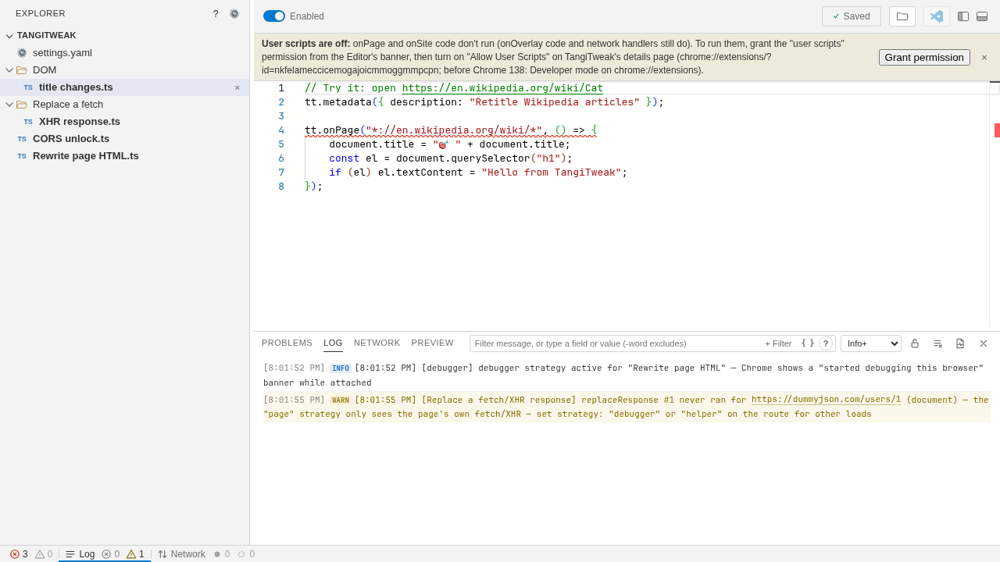
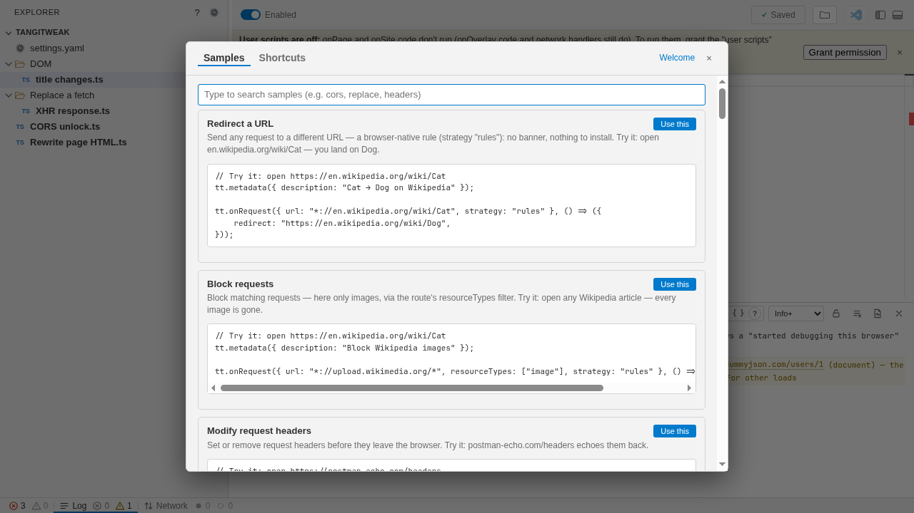

<p align="center"></p>

<h1 align="center">Wiretrick</h1>

Rewrite any request or response in your browser with a few lines of
TypeScript. Wiretrick is a ground-up rewrite of
[Resource Override](https://github.com/kylepaulsen/ResourceOverride), also
inspired by [Inssman](https://github.com/vvmgev/Inssman) and
[Tampermonkey](https://www.tampermonkey.net/) — userscripts, but built for
modifying requests and responses. The whole interface is a **script editor**:
each handler in a script names the URLs it handles and what to do — redirect,
block, edit headers, transform or replace bodies, patch the DOM, or draw its
own GUI over the page.

> [!WARNING]
> **Wiretrick is experimental.** I'm constantly experimenting with its
> scripting API, so it changes — sometimes in breaking ways — from release to
> release, and scripts written for one version may need updating for the next.
> Check the [changelog](CHANGELOG.md) before you update.



## Features

- **Scripts, not rule lists** — a Monaco code editor with IntelliSense, type checking,
  per-script enable toggles and adjustable parameters.
- **Hot apply** — saving a script, changing a param or a setting takes effect
  immediately: no extension reload, no browser restart. Edits made in your own
  editor apply the same way through folder sync.
- **Every kind of interception** — page fetch/XHR, documents, `<script>`,
  images and workers, through five [strategies](docs/strategies.md), named
  per handler. `page` is the lightest but
  only sees fetch/XHR (REST) calls; use `helper`, `extension` or `debugger` for
  robust interception; `rules` turns fixed blocks, redirects and header
  changes into browser-native rules.
- **Your own GUI on the page** — `wt.onPage({ url, dom: "overlay" }, …)` draws a script's panel in an
  overlay the page can't see or restyle (React and valtio built in);
  `wt.globalStore` (or per page, `wt.pageStore`) shares live state between it and the handlers, and `wt.onPage`
  code answers its calls ([overlays](docs/scripting.md#overlays--dom-overlay)).
- **No debugger banner needed** — the optional [local helper](docs/local-helper.md)
  intercepts at network level on Chrome without the "being debugged" bar.
- **Built-in devtools** — the Problems view lists what's wrong with your scripts
  right now (gone once fixed); the Log and Network views show what every script did,
  including original vs. modified bodies.
- **LLM-ready diagnostics** — when a script doesn't do what you expect,
  [Collect diagnostics](docs/editor.md#about-and-diagnostics) and hand the
  report to an LLM with "why isn't this working?". It carries your scripts,
  settings, the recent log and the requests the Network view recorded, with what each script did to them,
  so the model can pinpoint the cause. Cookies and authorization headers are redacted.
- **Install and share scripts** — open any URL ending in `.wiretrick.ts` (a gist, a GitHub file or folder, any site, a local file) to install it with the files it imports; the install page shows what it can do first. Installed scripts [update themselves](docs/packages.md#updates) unless an update can do more, which waits for your review.
- **Folder sync** — keep scripts, JSON data files and their folders as plain files in a synced folder of your choice.
- **Chrome (MV3), MV2 Chromium and Firefox.**

## Install

1. Download from [Releases](https://github.com/nimatrueway/wiretrick/releases):
   `wiretrick-mv3-vX.Y.Z.zip` for current Chrome / Edge / Brave,
   `wiretrick-firefox-vX.Y.Z.xpi` for Firefox, or
   `wiretrick-mv2-vX.Y.Z.zip` for MV2-capable Chromium.
2. Chromium: unzip, open `chrome://extensions`, enable **Developer mode** and
   **Load unpacked** the folder. Firefox: drag the `.xpi` onto Firefox (see
   [docs/install.md](docs/install.md#firefox) if it's unsigned).
3. Pin the icon — its badge counts the scripts active on the current tab (a
   network handler matched one of its requests, or `onPage` code ran on it;
   the popup marks which ones with a green dot). The badge turns red when one
   of them has an error (amber: a warning); hover the icon to see which.
   While a saved script is compiled and hot-reloaded, the icon fades and
   shows a spinner.

Signed `.crx` packages, building from source and the optional helper:
see [docs/install.md](docs/install.md).

## Quick start

Open the Editor (popup → **Open Editor**), click **+ New** and paste:

```ts
// Try it: open https://dummyjson.com/todos/1
wt.onResponseBody({ url: "*://dummyjson.com/todos/*", strategy: "helper" }, (ctx, body) => {
    const text = typeof body === "string" ? body : new TextDecoder().decode(body);
    const json = JSON.parse(text);
    json.todo = "Transformed by Wiretrick";
    return JSON.stringify(json, null, 2);
});
```

Or start from a sample: on first run the Editor opens a welcome page where
**Try it** adds a sample, turns it on and opens a real public site with it
running (later: **?** → **Welcome** or **?** → **Samples**).



## Documentation

| | |
|---|---|
| [Installing](docs/install.md) | release zips, signed crx, building from source |
| [Writing scripts](docs/scripting.md) | the `wt` API, routes, parameters, libraries, imports and data files, `wt.globalStore`/`wt.pageStore`/`wt.fetch`, `onPage`, overlays (`dom: "overlay"`), stacking, async handlers |
| [Installing and sharing scripts](docs/packages.md) | install from a URL, GitHub, a gist, a folder or a zip; the header; where files go; updates and rollback |
| [Interception strategies](docs/strategies.md) | `page` / `debugger` / `extension` / `helper` / `rules`, the default and per-handler choice, [which strategies keep the URL when replacing a response](docs/strategies.md#how-each-strategy-serves-a-replacement), the Missed warning, browser compatibility |
| [Local helper](docs/local-helper.md) | the `helper` strategy: install, how it works, security notes |
| [The Editor](docs/editor.md) | Code view, Problems, Log & Network views, folder sync, `settings.yaml` |
| [Glossary](GLOSSARY.md) | the words we use for Wiretrick's concepts |
| [Development](docs/development.md) | build, tests, releases, how the MV3 build works |

## License

[MIT](LICENSE)
