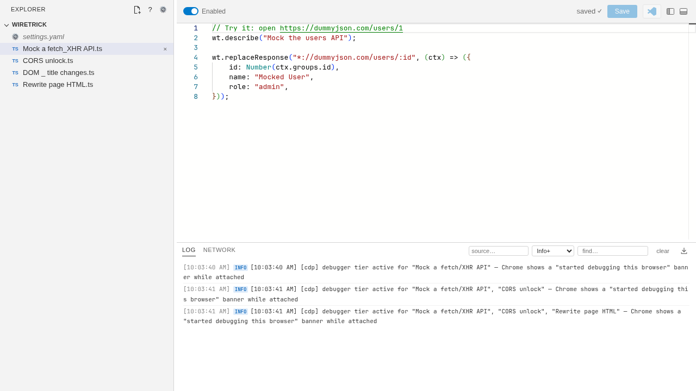

<p align="center"></p>

<h1 align="center">Wiretrick</h1>

Rewrite any request or response in your browser with a few lines of
TypeScript. Wiretrick is a ground-up rewrite of
[Resource Override](https://github.com/kylepaulsen/ResourceOverride), also
inspired by [Inssman](https://github.com/vvmgev/Inssman), where the
whole interface is a **script editor**: each handler in a script names the
URLs it handles and what to do — redirect, block, edit headers, transform or
replace bodies, or patch the DOM.



## Features

- **Scripts, not rule lists** — a Monaco code editor with IntelliSense, type checking,
  per-script enable toggles and adjustable parameters.
- **Hot apply** — saving a script, changing a param or a setting takes effect
  immediately: no extension reload, no browser restart. Edits made in your own
  editor apply the same way through folder sync.
- **Every kind of interception** — page fetch/XHR, documents, `<script>`,
  images and workers, through five [strategies](docs/strategies.md): one
  default in Settings, overridable per handler. `page` is the lightest but
  only sees fetch/XHR (REST) calls; use `helper`, `webRequest` or `debugger` for
  robust interception; `rules` turns fixed blocks, redirects and header
  changes into browser-native rules.
- **No debugger banner needed** — the optional [local helper](docs/process-helper.md)
  intercepts at network level on Chrome without the "being debugged" bar.
- **Built-in devtools** — the Log and Network views show what every script did,
  including original vs. modified bodies.
- **Folder sync** — keep scripts as plain files in a synced folder of your choice.
- **Chrome (MV3), MV2 Chromium and Firefox.**

## Install

1. Download from [Releases](https://github.com/nimatrueway/wiretrick/releases):
   `wiretrick-mv3-vX.Y.Z.zip` for current Chrome / Edge / Brave,
   `wiretrick-firefox-vX.Y.Z.xpi` for Firefox, or
   `wiretrick-mv2-vX.Y.Z.zip` for MV2-capable Chromium.
2. Chromium: unzip, open `chrome://extensions`, enable **Developer mode** and
   **Load unpacked** the folder. Firefox: drag the `.xpi` onto Firefox (see
   [docs/install.md](docs/install.md#firefox) if it's unsigned).
3. Pin the icon — its badge counts the enabled scripts matching the current tab.

Signed `.crx` packages, building from source and the optional helper:
see [docs/install.md](docs/install.md).

## Quick start

Open the Editor (popup → **Open Editor**), click **+ New** and paste:

```ts
// Try it: open https://dummyjson.com/todos/1
wt.onResponseBody("*://dummyjson.com/todos/*", (ctx, body) => {
    const text = typeof body === "string" ? body : new TextDecoder().decode(body);
    const json = JSON.parse(text);
    json.todo = "Transformed by Wiretrick";
    return JSON.stringify(json, null, 2);
});
```

Or click **?** → **Samples** for one-click starters against real public sites.


## Documentation

| | |
|---|---|
| [Installing](docs/install.md) | release zips, signed crx, building from source |
| [Writing scripts](docs/scripting.md) | the `wt` API, routes, parameters, libraries, `onDom`, stacking, async handlers |
| [Interception strategies](docs/strategies.md) | `page` / `debugger` / `webRequest` / `helper` / `rules`, the default and per-handler choice, [which strategies keep the URL when replacing a response](docs/strategies.md#how-each-strategy-serves-a-replacement), the Missed warning, browser compatibility |
| [Local helper](docs/process-helper.md) | the `helper` strategy: install, how it works, security notes |
| [The Editor](docs/editor.md) | Code view, Log & Network views, folder sync, `settings.yaml` |
| [Glossary](GLOSSARY.md) | the words we use for Wiretrick's concepts |
| [Development](docs/development.md) | build, tests, releases, how the MV3 build works |

## License

[MIT](LICENSE)
